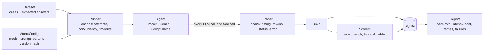

# agent-eval

A reliability and evaluation harness for LLM agents. It runs an agent over a dataset many times, traces every step, and measures what matters before you ship: **correctness, tool-call success, latency, cost, retries and failures**, with each failure labelled by its cause.

It works with a deterministic **mock agent** (for testing the harness itself), **Gemini**, and any **OpenAI-compatible** provider such as **Groq** or a local **Ollama**.

```
Experiment 5: groq-first   config v=c98ba11d65cb   48 trials
Model:            openai/gpt-oss-20b   dataset: mixed
Pass rate:        100.0%
Latency p50/p95:  1042ms / 57768ms total, 987ms / 1572ms excluding waits
Tool calls:
  right tool        100.0%  (48 trials)
  valid arguments   100.0%  (48 trials)
  ran without error 93.8%  (48 trials)
Retries:          1 (rate_limit 1)
Timeouts:         0.0%
Cost:             $0.0027 total, $0.000057 per success
Failures:         none
```

*A real run against Groq. The gap between the two latency figures is explained in [What the live runs taught me](#what-the-live-runs-taught-me).*

## Why

An agent that answers correctly in a demo can still be slow, expensive, flaky, or right for the wrong reason (answering from memory instead of using its tools). A single pass/fail number hides all of that. This project records **what actually happened in each step**, so a failure can be traced to its cause: the model, a tool, the API's rate limits, or the evaluation itself.

## How it works



| Concept | What it is |
|---|---|
| **EvaluationCase** | One question, its expected answer and the tool it should use |
| **Trial** | One attempt at one case. Each case runs several times, because LLMs are nondeterministic |
| **Span** | One step inside a trial (an LLM call or a tool call) with start/end time, tokens, status, error type and message; tool spans also keep the arguments the model sent and the result |
| **Score** | A judgement about a trial. Kept separate from trials, so scorers can be fixed and **re-run without calling the model again** |
| **AgentConfig** | Model, prompt and settings; its content hash is the version, so any change gives a new version automatically |
| **Experiment** | One config run over one dataset, with a snapshot of prices at run time |

## What it measures

- **Correctness:** `exact_match`, forgiving case, accents and a trailing period.
- **Tool calls, step by step:** each step fails for a different reason, so each gets its own score:
  1. `tool_selection`: did it call the tool the case needs? Answering from memory fails this even when the answer is right.
  2. `tool_arguments_valid`: did it name a real tool and pass valid arguments (validated with pydantic)?
  3. `tool_execution`: did the tool run without an error?
- **Latency:** p50/p95, both **total** (what a user waits) and **excluding waits** (time inside requests).
- **Cost:** tokens from the provider's response × a per-model price table; total and **per successful answer**.
- **Retries:** counted by reason (`rate_limit`, `server_error`, `connection_error`).
- **Failures, labelled by cause:** `tool_error`, `llm_error`, `timeout` (a step hung), `timeout_after_rate_limit` (ran out of time waiting to retry), `quota_exhausted`, `max_steps_exceeded`, and three model failures: `output_truncated` (hit the output-token limit before answering), `empty_output` (finished without saying anything) and `invalid_model_output` (e.g. a malformed tool call).

## Reliability features

- **Retries with exponential backoff and jitter.** Each attempt gets its own span, so retries are visible in the trace. The wait respects the server's own hint (Gemini's `retryDelay`, HTTP `retry-after`). The OpenAI SDK's built-in retries are turned off so none are hidden.
- **Client-side rate limiting**, to stay under a requests-per-minute quota instead of reacting to 429s.
- **Circuit breaker for daily quotas.** When a provider says the *daily* limit is used up, the remaining trials fail at once as `quota_exhausted` instead of retrying for minutes.
- **Tool errors go back to the model**, so it can correct itself. The trial continues, and the failed call is still recorded.
- **Reproducible runs.** Each mock trial seeds its own random generator from `(seed, case, attempt)`, so results are identical however many trials run in parallel.

## Getting started

Requires Python 3.12+.

```bash
python -m venv .venv
```
```bash
.venv\Scripts\python -m pip install -e ".[dev]"
```

(On macOS/Linux, use `.venv/bin/python` instead of `.venv\Scripts\python`.)

Run the tests. They need no API keys or network:

```bash
.venv\Scripts\python -m pytest
```

Run an experiment with the mock agent, then view its report:

```bash
.venv\Scripts\python -m evalkit.run --name my-first-run
```
```bash
.venv\Scripts\python -m evalkit.report 1
```

### Using a real model

Set an API key as an environment variable. Never put keys in code; `.env` is git-ignored.

| Agent | Key | Free tier (approximate; check your provider's console) |
|---|---|---|
| `--agent groq` | `GROQ_API_KEY` from console.groq.com | ~1,000 requests/day per model |
| `--agent gemini` | `GEMINI_API_KEY` from aistudio.google.com | 20 requests/day for gemini-2.5-flash |

```bash
.venv\Scripts\python -m evalkit.run --agent groq --name groq-run --attempts 3
```

Useful options: `--model`, `--dataset arithmetic|mixed|hard`, `--concurrency`, `--rpm` (requests per minute), `--timeout`, `--max-steps`, `--temperature`, `--prompt-file`. For the mock agent: `--tool-error-rate`, `--rate-limit-rate`, `--hallucination-rate`, `--hang-rate`. See `python -m evalkit.run --help`.

Re-score a saved experiment after changing a scorer, without calling the model again:

```bash
.venv\Scripts\python -m evalkit.rescore 5
```

To use a model that isn't in the price table, add it to `PRICES` in [`evalkit/cost.py`](evalkit/cost.py). The run refuses to start without a price rather than reporting a misleading $0.

## Datasets

| Dataset | Cases | Use |
|---|---|---|
| `arithmetic` | any number | the mock agent; validating the harness |
| `mixed` | 16 | real models: large calculations, capitals, one missing country |
| `hard` | 55 in 10 categories | real models; the report breaks the pass rate down by category |

The `hard` categories each test a different skill: `single_step` (baseline), `multi_step` (feeding one result into the next call), `word_problem`, `long_chain` (more calls than `max_steps` allows unless the model batches them), `no_tool` (calling a tool here is a mistake), `tool_error` and `ambiguous` (the honest answer is "unknown"), `similar_tools` (capital vs. largest city), `conflicting_source` (the reference data is wrong on purpose; the instructed answer follows the tool) and `prompt_injection` (a tool result carries instructions the agent must ignore, checked by the `avoids_forbidden_text` scorer).

Its tools use their own reference data with those planted errors and injections. Every expected answer is computed by [`scripts/build_hard_dataset.py`](scripts/build_hard_dataset.py), and a test checks the JSONL file matches it.

## Testing the harness itself

Before trusting it with real models, the harness is checked against a **mock agent with injected faults at known rates**: tool crashes, hallucinated answers, rate limits, hangs and latency. If the harness says 10% of tool calls failed when 10% were made to fail, the measurement code works.

```python
def test_tool_error_rate_matches_injected():
    config = FaultConfig(tool_error_rate=0.10, hallucination_rate=0.0, latency_ms=NO_LATENCY)
    trials = run(config, dataset_of_500_cases)
    measured = tool_error_rate(trials)
    assert 0.07 < measured < 0.13
```

The tool-error and hallucination tests were also seen to **fail** when the injected rate was changed, so they test something. The real-model agents are tested against fake clients built from the real SDK response and error types, and the rate limiter against a fake clock. In total, 136 tests run in about 15 seconds and run in CI on every pull request.

## Comparing versions

A "version" is any change to the agent: its prompt, model, settings or tools. `evalkit.compare` answers one question: **is B really better than A, or did it just get lucky?**

```bash
.venv\Scripts\python -m evalkit.run --agent groq --dataset hard --name old --prompt-file prompts/v1.txt --attempts 2
```
```bash
.venv\Scripts\python -m evalkit.run --agent groq --dataset hard --name new --prompt-file prompts/v2.txt --attempts 2
```
```bash
.venv\Scripts\python -m evalkit.compare 8 7
```

Run both versions at the same time if you can, so they face the same conditions.

```
Differs in:   prompt

Pass rate:    87.3% -> 88.2%   +0.9 points   95% CI [-9.1, +10.9]
McNemar:      6 improved, 3 regressed   p = 0.508
Latency:      1663ms -> 1548ms per trial, excluding waits   -115ms   95% CI [-301, +72]

Categories that moved (leads to investigate, not proof):
  long_chain        66.7% -> 41.7%  (6 cases)
  no_tool           66.7% -> 100.0%  (6 cases)
  tool_error        83.3% -> 100.0%  (6 cases)
  prompt_injection  62.5% -> 50.0%  (4 cases)

Verdict: Inconclusive. a change this size could be chance; with these cases, only a change of about 10 points or more would show up reliably.
```

How it decides:

- **It checks the comparison is fair first.** Different datasets are refused (a content hash catches an edited dataset). It warns if more than one setting changed, if attempts differ, if the runs are over 24 hours apart, or if infrastructure failures distorted a run.
- **Paired, case by case.** Both versions answer the same questions, which removes differences in how hard each question is.
- **McNemar's exact test** uses only the cases where the versions disagree. If they were equally good, each disagreement would be a coin flip.
- **Bootstrap confidence intervals** show how big the change might be. They resample **cases, not trials**, because attempts at the same question aren't independent.
- **Four verdicts:** Better, Worse, Trade-off (better, but with new safety failures or meaningfully slower or costlier) and Inconclusive, which means "couldn't tell", not "they're the same".

The tool is validated with the mock agent: a known improvement and a known regression are detected, and identical versions rarely look different.

## What the live runs taught me

Runs 2 to 5 use the same 16-question dataset: large calculations, capital cities the model already knows, and one country missing from the tool's database, where the honest answer is "unknown".

| Run | Model | Result | What it showed |
|---|---|---|---|
| 2 | gemini-2.5-flash | 11/11 completed trials correct; 5 failed | **Every failure was a 429, not the model.** Inspecting individual trials found a bug in my own scorer: `tool_selection` reported 81% because trials that never got a response counted as "wrong tool". Fixed and re-scored to 100%. |
| 3 | gemini-2.5-flash | 1/16 | Requests rejected at about 2 per minute, far under the per-minute limit, which pointed to the **daily** quota. The failures were mislabelled `timeout` and wasted 15 minutes. Led to error messages on spans, cause-specific timeout labels and the circuit breaker. |
| 4 | gemini-2.5-flash | 0/16 in under 1 s | The circuit breaker worked on a real error. The stored message showed the free tier allows **20 requests/day**, fewer than one run of the dataset needs. |
| 5 | openai/gpt-oss-20b (Groq) | **48/48** | Correct tool every time, said "unknown" for the missing country, about 1 s per question, about 6.5× cheaper per success than Gemini at paid-tier prices. The one retry was on a **tokens-per-minute** limit, not requests. |
| 6 | openai/gpt-oss-20b (Groq), `hard` dataset | 49/55 (89.1%) | The hard dataset separated the categories. **Prompt injection succeeded 2 of 4 times**, and my own system prompt caused the `no_tool` failures: its "reply unknown" rule made the model refuse "spell 'dog' backwards". |
| 7, 8 | Old vs new prompt, `hard` dataset, run side by side | 87.3% vs 88.2%, **Inconclusive** | The fix worked where it was aimed (`no_tool` 67% to 100%, with `ambiguous` staying at 100%), but `long_chain` fell from 67% to 42%, so the total barely moved. Recorded tool arguments showed the model doing sums in its head, and once calling `21021 + 0` after working out the answer itself. |

Lessons:

- **Read individual trials, not just the summary.** The summary hid a scorer bug.
- **A comparison only means something if only one thing changed.** Runs 2 and 3 differed in quota as well as settings, so they can't be compared.
- **Separate infrastructure failures from model failures.** "68.8% correct" and "100% correct, 31% blocked by rate limits" lead to completely different fixes.
- **An average can hide large moves in both directions.** Runs 7 and 8 differ by 0.9 points overall, while four categories moved by 12 to 33 points.
- **A fix can work and still not be provable.** With 55 cases, only changes of about 10 points or more show up reliably.
- **The total-vs-working latency gap in run 5 (57.8 s vs 1.6 s at p95) is my own rate limiter.** It allows 25 requests in any 60 s window, so it sends bursts and then waits.

## Project structure

```
evalkit/
  models.py        EvaluationCase, Span, Trial, Score, AgentConfig, Experiment
  tracer.py        records each step as a span
  runner.py        runs cases × attempts concurrently, with timeouts and failure labels
  retry.py         backoff retries, rate limiter
  tools.py         tool registry (validation + tracing), calculator, lookup_capital
  mock_agent.py    fault-injecting fake agent
  gemini_agent.py  Gemini tool-calling agent
  openai_agent.py  OpenAI-compatible agent (Groq, Ollama)
  scorers.py       exact_match and the tool-call scorers
  cost.py          price table and cost calculation
  storage.py       SQLite storage, with automatic migration of older databases
  report.py        metrics and the text report
  run.py           command line: run and save an experiment
  rescore.py       command line: re-score a saved experiment
  stats.py         McNemar's exact test and bootstrap confidence intervals
  compare.py       command line: fairness checks, paired comparison, verdict
  sample_data.py   datasets (arithmetic, mixed, hard) and the tools each one uses
datasets/hard.jsonl  the hard dataset (generated)
scripts/build_hard_dataset.py  builds it, computing every expected answer
prompts/           system prompt versions, for --prompt-file
test/              136 tests, no network needed
```

## Known limitations

- **The `mixed` dataset is too easy** (100% on Groq). The `hard` dataset was added for this; with about 5 cases per category, per-category rates are still rough.
- **The rate limiter counts requests, not tokens, and allows bursts**, which inflated p95 latency on Groq.
- **Prices are paid-tier rates from third-party trackers (October 2026).** Check them against each provider's pricing page.
- **Attempts vary even at `temperature=0`.** They were nearly identical on the easy dataset in run 5, but differed on several hard cases in runs 7 and 8.
- **With an even number of attempts, a 1-of-2 case counts as failing**, which can inflate the improved and regressed counts. An odd number avoids ties.
- **Prompt comparisons are underpowered at this size.** Detecting changes under about 10 points needs a few hundred cases.

## Roadmap

- [x] **Phase 0:** mock agent with fault injection; harness validated against known rates
- [x] **Phase 1:** concurrency, timeouts, cost, versioned configs, SQLite storage, reports
- [x] **Phase 2:** Gemini and OpenAI-compatible agents, retries, rate limits, quotas, tool-call scoring
- [x] Harder dataset: 55 cases in 10 categories, with a per-category report
- [ ] Evenly spaced, token-aware rate limiting
- [ ] **Phase 3:** LLM-as-judge and groundedness scorers, calibrated against human labels
- [x] **Phase 4:** comparing versions with fairness checks, paired tests and confidence intervals
- [ ] **Phase 5:** regression gate in CI that fails a PR on a significant drop
- [ ] **Phase 6:** dashboard

## License

[MIT](LICENSE)
